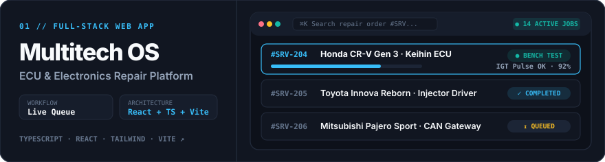
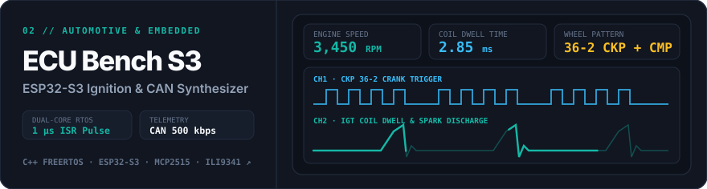
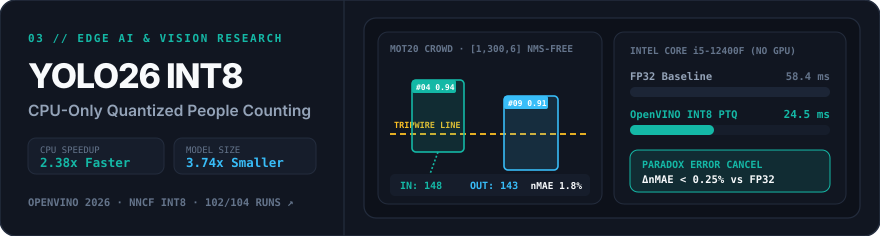

  <samp>
    <a href="https://aquarise.my.id">aquarise.my.id</a> ·
    <a href="https://www.linkedin.com/in/febnawan-fr/">linkedin</a> ·
    <a href="mailto:febnawanrochman2@gmail.com">febnawanrochman2@gmail.com</a> ·
    <a href="https://github.com/feb027?tab=repositories">repositories</a>
  </samp>

  <a href="https://aquarise.my.id">
    <picture>
      <source media="(prefers-color-scheme: dark)" srcset="./assets/hero-dark.svg">
      <source media="(prefers-color-scheme: light)" srcset="./assets/hero-light.svg">
      
    </picture>
  </a>

  <a href="https://github.com/feb027/Capstone_Multitech">
    <picture>
      <source media="(prefers-color-scheme: dark)" srcset="./assets/card-web-dark.svg">
      <source media="(prefers-color-scheme: light)" srcset="./assets/card-web-light.svg">
      
    </picture>
  </a>

  <a href="https://github.com/feb027/IgnitionCoilSimulator-S3">
    <picture>
      <source media="(prefers-color-scheme: dark)" srcset="./assets/card-ecu-dark.svg">
      <source media="(prefers-color-scheme: light)" srcset="./assets/card-ecu-light.svg">
      
    </picture>
  </a>

  <a href="https://github.com/feb027/Visikom-UAS">
    <picture>
      <source media="(prefers-color-scheme: dark)" srcset="./assets/card-vision-dark.svg">
      <source media="(prefers-color-scheme: light)" srcset="./assets/card-vision-light.svg">
      
    </picture>
  </a>

<table width="100%">
  <tr>
    <td width="33.3%" valign="top">
      <code>04 // RUST · WASAPI · COMPOSE</code> 
      <a href="https://github.com/feb027/mic-hp"><strong>mic-hp</strong></a> — Ultra-low-latency (<code>~2–10 ms</code>) wireless PC virtual microphone &amp; Android audio bridge.
    </td>
    <td width="33.3%" valign="top">
      <code>05 // CONVNEXT-V2 · FASTAPI · REACT</code> 
      <a href="https://github.com/feb027/Visikom-UAS"><strong>Mydria (Visikom-UAS)</strong></a> — Diabetic retinopathy screening on <code>APTOS 2019</code> with <code>Grad-CAM++</code> heatmaps.
    </td>
    <td width="33.3%" valign="top">
      <code>06 // PYTHON · MIDI SYNTH · 3 ★</code> 
      <a href="https://github.com/feb027/wwm-autobard"><strong>wwm-autobard</strong></a> — Automated MIDI &amp; Sky sheet music synthesizer for <em>Where Winds Meet</em>.
    </td>
  </tr>
</table>

  
<samp><strong>+ More Selected Repositories</strong> (Pattern-Gen ECU · ECUSniff · Manajemen Servis · CR-V Fan Controller · CogniPulse)</samp>

   

  - **[pattern-gen](https://github.com/feb027/pattern-gen)** — Programmable crank & camshaft (`CKP/CMP`) tooth-wheel signal generator for ECU bench testing.
  - **[ECUSniff](https://github.com/feb027/ECUSniff)** & **[IgnitionCoilTester](https://github.com/feb027/IgnitionCoilTester)** — `MCP2515 CAN-Bus` packet analyzer and hardware ignition coil tester for Multitech Workshop.
  - **[manajemen-servis](https://github.com/feb027/manajemen-servis)** — Web-based service intake, queue, and technician workflow management app.
  - **[control-fan-radiator](https://github.com/feb027/control-fan-radiator)** — Fail-safe embedded radiator fan thermal controller for Honda CR-V Gen 3 (`C++` / `Arduino Nano`).
  - **[cognipulse](https://github.com/feb027/cognipulse)** — Non-invasive neuro-telemetry web interface for cognitive fatigue assessment (`TypeScript` / `React`).

 

  <picture>
    <source media="(prefers-color-scheme: dark)" srcset="./assets/stats-dark.svg">
    <source media="(prefers-color-scheme: light)" srcset="./assets/stats-light.svg">
    
  </picture>

  

