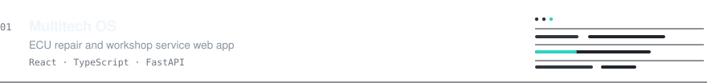
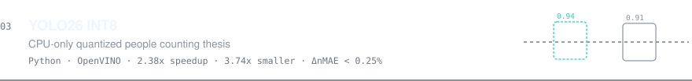

  <samp>
    <a href="https://aquarise.my.id">aquarise.my.id</a> ·
    <a href="https://www.linkedin.com/in/febnawan-fr/">linkedin</a> ·
    <a href="mailto:febnawanrochman2@gmail.com">febnawanrochman2@gmail.com</a> ·
    <a href="https://github.com/feb027?tab=repositories">repositories</a>
  </samp>

  <a href="https://aquarise.my.id">
    <picture>
      <source media="(prefers-color-scheme: dark)" srcset="./assets/hero-dark.svg">
      <source media="(prefers-color-scheme: light)" srcset="./assets/hero-light.svg">
      
    </picture>
  </a>

<strong>PROJECTS</strong>

<a href="https://github.com/feb027/Capstone_Multitech"><picture><source media="(prefers-color-scheme: dark)" srcset="./assets/row-web-dark.svg"><source media="(prefers-color-scheme: light)" srcset="./assets/row-web-light.svg"></picture></a>

<a href="https://github.com/feb027/IgnitionCoilSimulator-S3"><picture><source media="(prefers-color-scheme: dark)" srcset="./assets/row-ecu-dark.svg"><source media="(prefers-color-scheme: light)" srcset="./assets/row-ecu-light.svg"></picture></a>

<a href="https://github.com/feb027/hibah-riset"><picture><source media="(prefers-color-scheme: dark)" srcset="./assets/row-vision-dark.svg"><source media="(prefers-color-scheme: light)" srcset="./assets/row-vision-light.svg"></picture></a>

 

<table width="100%">
  <tr>
    <td width="33.3%" valign="top">
      <a href="https://github.com/feb027/mic-hp"><strong>mic-hp</strong></a> 
      <code>Rust · WASAPI · Compose</code> 
      Wireless PC virtual mic (~2 ms latency) from Android.
    </td>
    <td width="33.3%" valign="top">
      <a href="https://github.com/feb027/Visikom-UAS"><strong>Mydria</strong></a> 
      <code>ConvNeXt-V2 · FastAPI · React</code> 
      Diabetic retinopathy screening on APTOS 2019 with Grad-CAM++.
    </td>
    <td width="33.3%" valign="top">
      <a href="https://github.com/feb027/wwm-autobard"><strong>wwm-autobard</strong></a> 
      <code>Python · MIDI · 3 ★</code> 
      Automated MIDI and sheet music player for <em>Where Winds Meet</em>.
    </td>
  </tr>
</table>

  
<samp>More repositories (pattern-gen · ECUSniff · manajemen-servis · control-fan-radiator · cognipulse)</samp>

   

  - **[pattern-gen](https://github.com/feb027/pattern-gen)**: Crank and camshaft (`CKP/CMP`) tooth-wheel signal generator for ECU bench testing.
  - **[ECUSniff](https://github.com/feb027/ECUSniff)** & **[IgnitionCoilTester](https://github.com/feb027/IgnitionCoilTester)**: `MCP2515 CAN-Bus` analyzer and hardware ignition coil tester for Multitech Workshop.
  - **[manajemen-servis](https://github.com/feb027/manajemen-servis)**: Service intake, queue, and technician workflow web app.
  - **[control-fan-radiator](https://github.com/feb027/control-fan-radiator)**: Radiator fan thermal controller for Honda CR-V Gen 3 (`C++` / `Arduino Nano`).
  - **[cognipulse](https://github.com/feb027/cognipulse)**: Cognitive fatigue web assessment tool (`TypeScript` / `React`).

 

  <picture>
    <source media="(prefers-color-scheme: dark)" srcset="./assets/stats-dark.svg">
    <source media="(prefers-color-scheme: light)" srcset="./assets/stats-light.svg">
    
  </picture>

