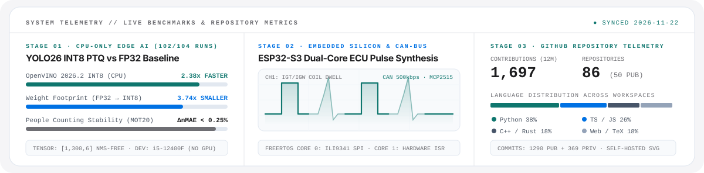

  <samp>
    <a href="https://aquarise.my.id">aquarise.my.id</a> ·
    <a href="https://www.linkedin.com/in/febnawan-fr/">linkedin</a> ·
    <a href="mailto:febnawanrochman2@gmail.com">febnawanrochman2@gmail.com</a> ·
    <a href="https://github.com/feb027?tab=repositories">repositories</a>
  </samp>

  <a href="https://aquarise.my.id">
    <picture>
      <source media="(prefers-color-scheme: dark)" srcset="./assets/hero-dark.svg">
      <source media="(prefers-color-scheme: light)" srcset="./assets/hero-light.svg">
      
    </picture>
  </a>

### Current Focus

- **`01 // CPU-Only Edge Vision Research`** : Final-year Informatics research at **Universitas Siliwangi** evaluating post-training `INT8` quantization (`OpenVINO 2026.2 NNCF` & `ONNX Runtime`) on NMS-free `YOLO26`, `YOLO11`, and `YOLOv10` (`[1,300,6]`) across multi-object tracking (`ByteTrack`, `BoT-SORT`, `OC-SORT`, `C-BIoU`) and people counting pipelines (`102/104` benchmark runs on CPU without GPU acceleration).
- **`02 // High-Craft Web Interfaces`** : Designing and engineering fast, restraint-first web applications in `TypeScript`, `React`, `Next.js`, `Svelte`, `Tailwind CSS`, and `FastAPI` built around Swiss grid typography and tactile micro-interactions.
- **`03 // Automotive Diagnostics & Embedded Silicon`** : Building Dual-Core `ESP32-S3` (`FreeRTOS`) ECU bench simulators, `CAN-Bus` (`MCP2515`) packet analyzers, and operational software for **Multitech** automotive electronics workshop.

  <picture>
    <source media="(prefers-color-scheme: dark)" srcset="./assets/telemetry-dark.svg">
    <source media="(prefers-color-scheme: light)" srcset="./assets/telemetry-light.svg">
    
  </picture>

---

### Selected Engineering Work

  
<strong>01 // Computer Vision, Edge AI &amp; Scientific Research</strong> · <code>Python 3.11 · YOLO26 · OpenVINO · NNCF INT8 · ONNX · ConvNeXt-V2</code>

   

  | System / Project | Architecture & Measured Outcome | Stack |
  | :--- | :--- | :--- |
  | **INT8 YOLO26 CPU-Only People Counting** *(S1 Thesis)* | Full-factorial quantization and tracking benchmark across `CrowdHuman` and `MOT20` (`102/104` CPU-only runs on Intel Core `i5-12400F`). Achieves **`2.00x–2.38x`** inference speedup and **`3.74x`** model compression on `OpenVINO 2026.2 INT8` with **`< 0.25%`** normalized counting error shift (`ΔnMAE`). | `Python 3.11` · `YOLO26/11/10` · `OpenVINO` · `NNCF` · `TrackEval` |
  | **[Visikom-UAS (Mydria)](https://github.com/feb027/Visikom-UAS)** | Clinical Diabetic Retinopathy grading prototype trained on `APTOS 2019` with Ben Graham retinal preprocessing, Quadratic Weighted Kappa optimization, and `Grad-CAM++` visual explainability heatmaps. | `ConvNeXt-V2` · `ONNX Runtime` · `FastAPI` · `React` |
  | **[Industrial Scale OCR (`ocr-timbangan-industrial`)](https://github.com/feb027/ocr-timbangan-industrial)** | Automated 7-segment digital indicator recognition pipeline designed for harsh industrial lighting conditions using `PP-OCRv6` (`PaddleOCR 3.0`). | `PaddleOCR 3.0` · `OpenCV` · `Python` |
  | **[IdSarcasm Reproduction](https://github.com/feb027/idsarcasm-reproduction)** & **[MelonAI](https://github.com/feb027/melon-ai)** | Transformer fine-tuning for Indonesian sarcasm detection and multi-modal acoustic/visual fruit ripeness classification. | `PyTorch` · `Transformers` · `TypeScript` |

  
<strong>02 // Automotive Electronics, Embedded Firmware &amp; Low-Latency Systems</strong> · <code>C/C++ · ESP32-S3 FreeRTOS · CAN-Bus · Rust · WASAPI</code>

   

  | System / Project | Architecture & Measured Outcome | Stack |
  | :--- | :--- | :--- |
  | **[IgnitionCoilSimulator-S3](https://github.com/feb027/IgnitionCoilSimulator-S3)** & **[IgnitionCoilTester](https://github.com/feb027/IgnitionCoilTester)** | Dual-Core `ESP32-S3` (`FreeRTOS`) diagnostic bench instrument for **Multitech Workshop**. Core 0 drives a flicker-free `ILI9341` SPI TFT using partial dirty-rect redraws while Core 1 generates microsecond-accurate `IGT/IGW` coil dwell pulses. | `C++` · `ESP32-S3` · `FreeRTOS` · `ILI9341 SPI` |
  | **[ECUSniff](https://github.com/feb027/ECUSniff)** & **[Pattern-Gen](https://github.com/feb027/pattern-gen)** | Real-time `CAN-Bus` (`MCP2515`) frame sniffer, OBD-II telemetry decoder, and programmable crank/camshaft (`CKP/CMP`) tooth-wheel signal generator for ECU bench testing. | `C++` · `MCP2515 CAN` · `ESP32` · `JavaScript` |
  | **[Honda CR-V Thermal Controller (`control-fan-radiator`)](https://github.com/feb027/control-fan-radiator)** | Fail-safe embedded radiator fan controller for Honda CR-V Gen 3 with non-linear ECT sensor voltage curve calibration and hysteresis protection. | `C++` · `Arduino Nano` · `ADC Calibration` |
  | **[mic-hp](https://github.com/feb027/mic-hp)** | Ultra-low-latency (`~2–10 ms`) wireless audio transport and virtual microphone bridge linking Android devices to Windows PCs over raw UDP/USB sockets. | `Rust` · `Windows WASAPI` · `Kotlin` · `Jetpack Compose` |

  
<strong>03 // Full-Stack Web Applications &amp; Data Engineering</strong> · <code>TypeScript · React · Next.js · Svelte · Tailwind CSS · FastAPI</code>

   

  | System / Project | Architecture & Measured Outcome | Stack |
  | :--- | :--- | :--- |
  | **[Capstone Multitech](https://github.com/feb027/Capstone_Multitech)** & **[Manajemen Servis](https://github.com/feb027/manajemen-servis)** | Production service management and repair tracking platform for automotive electronics workshops, covering intake diagnostics, technician queues, and financial ledgering. | `TypeScript` · `React` · `Vite` · `Tailwind CSS` |
  | **[CogniPulse](https://github.com/feb027/cognipulse)** | Non-invasive neuro-telemetry web interface for real-time cognitive fatigue assessment and biometric stream visualization. | `TypeScript` · `React` · `Telemetry UI` |
  | **[ETL BPS Analytics (`etl-bps-dashboard-analitik`)](https://github.com/feb027/etl-bps-dashboard-analitik)** & **[BPS Assistant](https://github.com/feb027/bps-asisten-data-penduduk)** | Automated demographic ETL data pipeline and interactive regional statistics dashboard engineered for **Badan Pusat Statistik (BPS)**. | `Python` · `ETL Pipeline` · `Interactive Dashboard` |
  | **[HybriDFS](https://github.com/feb027/HybriDFS)** & **[WWM AutoBard](https://github.com/feb027/wwm-autobard)** | Hybrid cloud-edge distributed file system architecture in Python and real-time MIDI hardware input synthesizer (`3 ★`). | `Python` · `Distributed Systems` · `Low-Level Input` |

---

### Technical Matrix

| Layer | Core Technologies & Tooling |
| :--- | :--- |
| **`Vision & Edge AI`** | `Python 3.11` · `Ultralytics YOLO26 / YOLO11 / YOLOv10` · `OpenVINO 2026.2` · `NNCF INT8 PTQ` · `ONNX Runtime` · `PyTorch` · `ConvNeXt-V2` · `PP-OCRv6` · `TrackEval` (`ByteTrack`, `BoT-SORT`, `OC-SORT`, `C-BIoU`) |
| **`Frontend & Web`** | `TypeScript` · `React` · `Next.js` · `Svelte` · `Vite` · `Tailwind CSS` · `Base UI / Radix` · `Motion` · `FastAPI` · `Bun` · `Django` · `SQLite` |
| **`Embedded & Systems`** | `C / C++` · `ESP32 & ESP32-S3 (Dual-Core FreeRTOS)` · `Arduino Nano` · `MCP2515 CAN-Bus` · `ILI9341 SPI Display` · `Rust` · `Windows WASAPI` · `Jetpack Compose` |
| **`Environment & Ops`** | `Windows 11 Native Workstation (i5-12400F)` · `Ubuntu 24.04 Homelab Server` · `Linux VPS & Tailscale Mesh` · `Git & GitHub Actions` · `XeLaTeX / Pandoc Deterministic Academic Publishing` |

---

  <samp>
    Febnawan Fatur Rochman (Aquarise) · Tasikmalaya, Indonesia · <a href="https://aquarise.my.id">aquarise.my.id</a>
  </samp>

