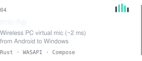
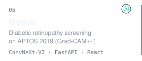
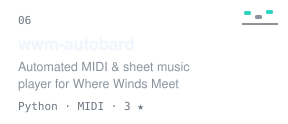

<a href="https://aquarise.my.id"><picture><source media="(prefers-color-scheme: dark)" srcset="./assets/nav-web-dark.svg"><source media="(prefers-color-scheme: light)" srcset="./assets/nav-web-light.svg"></picture></a><a href="https://www.linkedin.com/in/febnawan-fr/"><picture><source media="(prefers-color-scheme: dark)" srcset="./assets/nav-linkedin-dark.svg"><source media="(prefers-color-scheme: light)" srcset="./assets/nav-linkedin-light.svg"></picture></a><a href="mailto:febnawanrochman2@gmail.com"><picture><source media="(prefers-color-scheme: dark)" srcset="./assets/nav-mail-dark.svg"><source media="(prefers-color-scheme: light)" srcset="./assets/nav-mail-light.svg"></picture></a><a href="https://github.com/feb027?tab=repositories"><picture><source media="(prefers-color-scheme: dark)" srcset="./assets/nav-repos-dark.svg"><source media="(prefers-color-scheme: light)" srcset="./assets/nav-repos-light.svg"></picture></a>

  <a href="https://aquarise.my.id">
    <picture>
      <source media="(prefers-color-scheme: dark)" srcset="./assets/hero-dark.svg">
      <source media="(prefers-color-scheme: light)" srcset="./assets/hero-light.svg">
      
    </picture>
  </a>

Informatics student at Universitas Siliwangi. Currently working on my undergraduate thesis on INT8 quantization for CPU-only YOLO26 people counting, alongside workshop web applications and ESP32 automotive tools.

<strong>PROJECTS</strong>

<a href="https://github.com/feb027/Capstone_Multitech"><picture><source media="(prefers-color-scheme: dark)" srcset="./assets/row-web-dark.svg"><source media="(prefers-color-scheme: light)" srcset="./assets/row-web-light.svg"></picture></a>

<a href="https://github.com/feb027/IgnitionCoilSimulator-S3"><picture><source media="(prefers-color-scheme: dark)" srcset="./assets/row-ecu-dark.svg"><source media="(prefers-color-scheme: light)" srcset="./assets/row-ecu-light.svg"></picture></a>

<a href="https://github.com/feb027/hibah-riset"><picture><source media="(prefers-color-scheme: dark)" srcset="./assets/row-vision-dark.svg"><source media="(prefers-color-scheme: light)" srcset="./assets/row-vision-light.svg"></picture></a>

<a href="https://github.com/feb027/mic-hp"><picture><source media="(prefers-color-scheme: dark)" srcset="./assets/col-michp-dark.svg"><source media="(prefers-color-scheme: light)" srcset="./assets/col-michp-light.svg"></picture></a><a href="https://github.com/feb027/Visikom-UAS"><picture><source media="(prefers-color-scheme: dark)" srcset="./assets/col-mydria-dark.svg"><source media="(prefers-color-scheme: light)" srcset="./assets/col-mydria-light.svg"></picture></a><a href="https://github.com/feb027/wwm-autobard"><picture><source media="(prefers-color-scheme: dark)" srcset="./assets/col-autobard-dark.svg"><source media="(prefers-color-scheme: light)" srcset="./assets/col-autobard-light.svg"></picture></a>

  
<samp>More repositories (pattern-gen · ECUSniff · manajemen-servis · control-fan-radiator · cognipulse)</samp>

   

  - **[pattern-gen](https://github.com/feb027/pattern-gen)**: Crank and camshaft (`CKP/CMP`) tooth-wheel signal generator for ECU bench testing.
  - **[ECUSniff](https://github.com/feb027/ECUSniff)** & **[IgnitionCoilTester](https://github.com/feb027/IgnitionCoilTester)**: `MCP2515 CAN-Bus` analyzer and hardware ignition coil tester for Multitech Workshop.
  - **[manajemen-servis](https://github.com/feb027/manajemen-servis)**: Service intake, queue, and technician workflow web app.
  - **[control-fan-radiator](https://github.com/feb027/control-fan-radiator)**: Radiator fan thermal controller for Honda CR-V Gen 3 (`C++` / `Arduino Nano`).
  - **[cognipulse](https://github.com/feb027/cognipulse)**: Cognitive fatigue web assessment tool (`TypeScript` / `React`).

 

  <picture>
    <source media="(prefers-color-scheme: dark)" srcset="./assets/stats-dark.svg">
    <source media="(prefers-color-scheme: light)" srcset="./assets/stats-light.svg">
    
  </picture>

